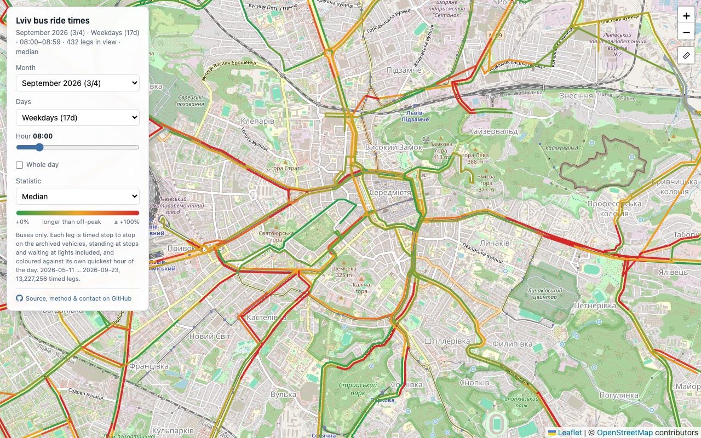
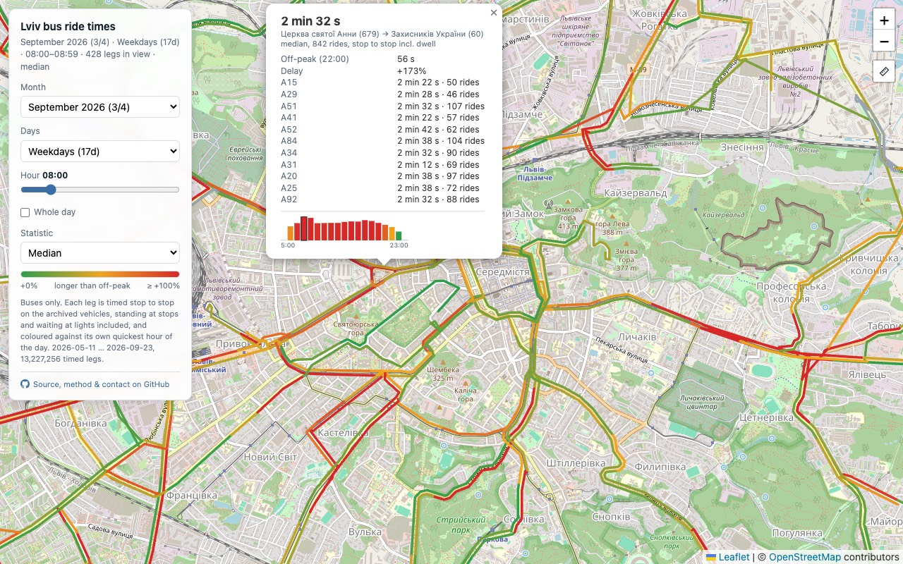

# gtfs-speedmap

An OSM map of **bus ride time** in Lviv. Every stop-to-stop leg of the network is drawn along the
street the buses drive, one line per direction of travel, and coloured by how much longer it takes
at the chosen hour than at **its own quickest hour of the day** — green +0%, red +100% and up.
Hour-of-day slider, month picker, weekday/weekend split. Clicking a leg shows its time per route
and hour by hour; a ruler times the ride between any two points.



Built from the GTFS-RT vehicle-position snapshots that
[`gtfs-collector`](../gtfs-collector) archives to Cloudflare R2.

```
R2  raw/YYYY-MM-DD/*.pb           GTFS-RT snapshots, every ~10 s
R2  static/YYYY-MM-DD/static.zip  GTFS schedule as archived that day
        │  python -m speedmap.ingest --all   (each snapshot fetched once, fed to both passes)
        ▼                                       ▼
data/seg/YYYY-MM-DD.parquet                 data/agg/YYYY-MM-DD.parquet
  stop-to-stop times, keyed                   speed pass, not on the map
  (month, hour, route, direction, stop pair)  (see "The speed pass" below)
data/seghist/YYYY-MM-DD.parquet             data/hist/YYYY-MM-DD.parquet
  the same key plus a 5-second bin
data/paths/YYYY-MM.json                     route shapes and stop order, from the schedule
        │  python -m speedmap.sync push     ⇄  R2 derived/
        │  python -m speedmap.build_web
        ▼
web/data/paths-{month}.json                 route lines and stop order
web/data/rides-{month}-{days}-{hour}.json   per-leg times per route — the map and the ruler
web/data/month-{month}.json, index.json     menus
        │  make deploy
        ▼
Cloudflare Worker (assets-only)
```

## What the colour means

A leg is the stretch between two adjacent stops, timed from arriving at one to arriving at the
next, so standing at the stop and waiting at lights are part of it. Most legs are driven by more
than one route; the map draws the stop pair once and pools the routes' times, weighted by how
many rides each contributed.

Each leg is then compared only with itself. Its **off-peak** is its quickest hour of the same
month, day type and statistic, among hours with at least `OFFPEAK_MIN_RIDES` (10) pooled rides,
and the colour is `time ÷ off-peak − 1`: green at +0%, through amber, red at `DELAY_HIGH` (+100%)
and beyond. That separates congestion from distance — a long leg on the edge of town is not red
for being long, and a short one in the centre is red only if rush hour stretches it. A leg with no
off-peak (too few rides in every hour) is drawn grey.

Lines are nudged to the right of their direction of travel, so the two directions of a street lie
side by side as the lanes do, and widen with zoom. A click picks the line it landed on.



The popup gives the pooled time and how many rides it rests on, the off-peak time and its hour,
the delay, each route that drives the leg with its own time and ride count, and a bar per hour of
the day coloured the same way. Pooling, off-peak and colour are all computed in the browser from
the per-route files, so changing the statistic or hour refetches nothing it already has.

## What counts as a ride

Every GTFS-RT entity is a candidate; it survives only if all of the following hold.

| Filter | Why |
|---|---|
| Route is a **bus** | `route_type == 3` **and** the short name does not start with `Тр`. `route_type` alone is not enough: Lviv trolleybuses (`Тр22`…`Тр38`) are published as `route_type=3`, and trams are `route_type=0`. |
| Vehicle timestamp is fresh | The feed republishes vehicles whose own `timestamp` is hours old (p50 = 14 s but p99 ≈ 17 h). Entities more than `STALE_MAX_S` behind the feed header are ghosts. |
| `(vehicle_id, timestamp)` not seen before | The collector polls every 10 s and the feed repeats unchanged entities. |
| Inside the Lviv bbox | Drops stray coordinates. |

Nothing near a stop is dropped: standing at a stop is part of the ride this pass is here to measure.

## How a leg is timed

[`segments.py`](src/speedmap/segments.py) reassembles each vehicle's day into runs, finds the
moment each run came nearest to every stop on its route's path (within `STOP_PASS_RADIUS_M`), and
keeps the elapsed time between adjacent stops.

Legs are keyed by the **stop pair**, not by the trip, so every variant of a route feeds the same
leg, and a leg runs arrival to arrival — which makes the sum across a range telescope into exactly
the time between arriving at the first stop and arriving at the last.

| Rejected | Why |
|---|---|
| A leg spanning a feed hole longer than `SEG_GAP_MAX_S` | The vehicle was unobserved across it, so the leg may not be the leg it looks like. |
| A leg longer than `SEG_MAX_S` | Not a leg: a bus that broke down, was pulled from service, or sat out a diversion. |
| A leg that runs backwards | Nearest approach can land out of order when two stops are close and the GPS wanders. |
| A silence longer than `RUN_GAP_MAX_S` | Ends the run. A vehicle keeps its trip_id through a layover, so without this a "leg" could span the turnaround. |
| A leg with fewer than `SEG_MIN_OBS` observations | One bus having a bad morning is not a median. Reported as a hole, not filled in silently. |

About 1% of candidate legs are rejected, and 96% of the 3,107 adjacent stop pairs in the network
have enough observations to publish.

Nothing in this pass reads the timetable, which makes the timetable a free check on it. Against the
`stop_times.txt` of the schedule the vehicles were running, over the 3,038 pairs both have:

| observed ÷ scheduled | p10 | median | p90 |
|---|---|---|---|
| | 0.53 | **0.94** | 1.76 |

Median observed leg 111 s against 120 s scheduled — buses beat the timetable slightly more often
than they miss it, and the spread either side, hour by hour, is what the map shows.

## Weekdays and weekends

Averaging the whole week together hides the rush hour, so the map opens on weekdays and offers
weekends and all days beside them. Saturday and Sunday are close enough to each other, and far
enough from a weekday, that they share one "weekend" bucket rather than thinning every leg's rides
three ways. The day type comes from each parquet's filename, so the split costs no extra pass over
R2.

## Which statistic

`data/seg/` keeps the running sums and `data/seghist/` a leg-time histogram in `SEG_BIN_S` bins,
so both statistics come out of one build.

| Statistic | What it answers |
|---|---|
| Median | How a leg usually goes; robust to the one bus that sat out a diversion. The default. |
| Average | The figure that adds up along a journey — see the ruler below. |

A leg seen on fewer than `SEG_MIN_OBS` rides in a slot is left out (`null`) rather than guessed.

## Ride time between two points

The ruler button beside the zoom controls answers "how long will this take me". Drop a point where
you are and another where you are going, and it lists every route that runs between them, timed on
the same stop-to-stop legs as the map.

### From two points, not two stops

The legs are measured stop to stop; the question is never asked that way. Both ends of the ruler
are projected onto each route's **shape** — the street the bus actually drives, from the schedule's
`shapes.txt` — and a route qualifies when it passes within `RIDE_NEAR_M` of both, in the order it
drives them. The stops are then just the marks along that line: a stretch that covers three and a
half legs is charged three and a half legs, the part-leg in proportion to how much of it the
stretch covers. That assumes an even pace across one leg, which is a 460 m block at the median.

Three things that had to be got right, each of which was wrong first:

| Trap | What it did | Fix |
|---|---|---|
| A route that doubles back | Placed the two ends on different passes, so 1.15 km of street came out as 2.6 km at 32 km/h | Take every local minimum of the distance to the line, then the pass-pair that gives the shortest way round |
| Stops matched to the shape one at a time | Put a stop on whichever pass was nearer; forcing each after the last threw А58's stops onto its return leg, a 23 km jump between neighbours | Match the whole sequence at once (Viterbi), with slack for the few-metre inversions of a tight turn |
| A generous radius | At 250 m a route on the next street qualified and then reported its own longer way round | 150 m to the line, plus a cap on how far round the houses a route may go against the straight line |

Seven of the 110 route-directions have stops their shape cannot account for; those fall back to the
chain of their own stops, which is the same idea at lower resolution.

Routes are listed fastest first, each with the stops it boards and alights at and how many rides the
figure rests on. A leg nobody was seen running in that selection is filled with the route's own
average leg and the row says how many of them were. Picking a route draws the stretch being timed.

Beside each time sits how much longer it takes than off-peak: the quickest hour of the same month
and day type over the same stretch, on the same statistic, among hours with at least 10 rides seen.

### Why the average is offered beside the median

Only the mean is additive. The sum of a route's per-leg means is the mean of the whole ride; the
sum of its per-leg medians is **not** the median of the ride, because leg times are right-skewed and
a bus that is late on one leg is late on the next. Over a ten-leg journey that compounds into a
figure that is simply too fast, which is exactly how the bug was reported.

Measured against the vehicles themselves — Рясне-2 → Ковча, ten legs, departures in the 08:00 hour
of six July weekdays, journeys reconstructed from the raw archive rather than from any aggregate:

| route | Σ leg medians | Σ leg means | real journey median | real journey mean |
|---|---|---|---|---|
| А06 | 22.1 | 25.1 | **26.0** | 26.4 |
| А11 | 22.2 | 24.7 | **25.3** | 26.4 |
| А49 | 23.2 | 24.1 | **22.1** | 25.0 |

The summed mean lands within about 5% of the real journey; the summed median runs 10–15% short.
The residual on the mean is legs the run never produced a pass pair for — 13% of А06's legs, which
is 19% of its clock — filled in from other runs.

The ruler still opens on the median, matching the map, because for a *single* leg it is the more
robust figure. It is the sum that misleads — switch to the average for a long ride.

Three things it does not claim. It does not know when the next bus leaves, so waiting time is
absent and a route running every 40 minutes reads the same as one every 6. A part-leg is priced by
distance, so a stretch that stops short of a stop is charged an even share of that leg rather than
the queue at its end. And the figures describe the buses that ran, not the timetable.

## Keeping it current

A GitHub Actions job ([`.github/workflows/rebuild.yml`](.github/workflows/rebuild.yml)) runs at
02:00 UTC on the 1st, 8th, 15th and 22nd. Ingest stops at yesterday, so the running month is always a
whole number of weeks in, and the month picker says so: *September 2026 (1/4)*, *(1/2)*, *(3/4)*.
The run on the 1st closes the month just finished, which from then on shows its day count like
the rest. A running month with less than a week of data is left out of the menu.

Each month is built on its own runner, from its own days only, so memory stays at one month's
worth however long the archive grows. Every off-peak is taken from the month itself, so a
finished month never has to be rebuilt because a later one arrived. Its map files are kept in R2 under `derived/web/YYYY-MM/`, and
the deploy job gathers every month from there and writes `index.json`. A normal run therefore
builds one month: the one still running. The run on the 8th also rebuilds the month before, so a
failed run on the 1st still gets that month closed a week later rather than left at 3/4.

After changing the build, start the job by hand from the Actions tab with months `all` — every
month then gets its own runner in parallel — or name the months, `2026-07 2026-08`. By hand locally:

```bash
make update   # ingest the new days, rebuild every month, deploy
```

`make ingest` only reads days missing from `data/agg/` or `data/seg/`, so a week costs a few minutes
locally, and a quarter of an hour on a runner. The map carries its own date range in the panel, so
a stale deploy says so rather than pretending to be current.

`data/` is git-ignored and takes hours to rebuild from scratch. `speedmap.sync` mirrors it into the
same bucket under `derived/` — the four per-day parquet directories, each month's route geometry
and `depots.json`, without which the depot yards would count as street. The runners start empty and
depend on this:

```bash
make push     # upload aggregates missing remotely
make pull     # download aggregates missing locally
```

Both are off the local `make update` path — on the machine that already holds `data/` there is
nothing to fetch. The parquets are immutable once written, so either direction is a filename
comparison and nothing more. A local `make update` should be followed by `make push`, or the next
runner re-ingests those days (harmless, just slow).

The job needs these repository secrets: `R2_ACCOUNT_ID`, `R2_ACCESS_KEY_ID`,
`R2_SECRET_ACCESS_KEY` (as in `.env`), and `CLOUDFLARE_API_TOKEN` (a token with *Workers Scripts:
Edit*) with `CLOUDFLARE_ACCOUNT_ID`.

## Setup

```bash
pip install -e ".[dev]"
cp .env.example .env    # R2 credentials — same bucket and keys as gtfs-eta
```

## Use

```bash
make ingest                   # every finished day in R2 (not today, UTC); resumable
make ingest DATE=2026-07-15   # one day
make build                    # merge into web/data/*.json
make serve                    # http://localhost:8000
make test
make deploy                   # publish web/ as it stands, no rebuild (Node from .nvmrc via nvm)
make deploy-data              # build every month, then publish
make update                   # ingest new days, then deploy
```

`web/data/*.json` is generated and git-ignored, so the deploy uploads whatever the last `make build`
produced. `make deploy` is for code: it skips the build and ships `web/data/` as it is on disk —
Wrangler only uploads files the edge does not already hold — and refuses when `web/data/index.json`
is missing, since an assets-only deploy without it would take the live data down. `make deploy-data`
runs `build` first; `make update` uses it.

`make ingest` reads each day's ~245 MB of snapshots once and feeds both passes — the speed cells
(`aggregate.py`) and the leg times (`segments.py`) — and only for a pass whose output is missing.
A new day costs a couple of minutes. `ARGS=--force` redoes days already on disk; add
`--only speed` or `--only segments` to redo just one pass after changing its filters.

Days run side by side (`JOBS`, default 3), each in its own process with `WORKERS` fetch threads.
The limit is R2 throughput, not CPU, so more jobs mostly add memory (~1 GB each); raise it on a
faster link.

A day that fails is retried after 30, 60 and 120 s, which rides out a Wi-Fi drop or the minute after
a wake from sleep. Three days in a row failing even so stops the run instead of failing the rest of
the archive in seconds; `caffeinate -i` keeps the Mac from idling to sleep but not from sleeping on
a closed lid, so keep it open (or on power with an external display) through a full `--force`.

## The speed pass

The same read of the archive also feeds a second pass, [`aggregate.py`](src/speedmap/aggregate.py),
which the map no longer shows. It keeps per-day sums and speed histograms per 25 m cell and
direction of travel in `data/agg/` and `data/hist/`, dropping samples near a stop on the vehicle's
own trip, at either terminal and inside a depot. It stays because
[`depots.py`](src/speedmap/depots.py) mines those aggregates for depots and layover yards: cells
that are motionless, busy, away from any mid-route stop and still motionless across many separate
hours of the day.

[`data/depots.json`](data/depots.json) is the result, curated against OpenStreetMap and committed;
`tests/test_depots.py` checks its shape. It masks the speed pass only — leg times never see it.

```bash
python -m speedmap.depots           # discover, writes data/depots.json
python -m speedmap.depots --list    # show what is on file
python -m speedmap.depots --merge   # keep known sites, add newly found ones
```

Discovery needs aggregates built **without** the mask, so plain `discover` refuses to overwrite an
existing file; `--merge` widens it from masked ones. Re-run the pass with
`make ingest ARGS="--force --only speed"`.

## Tuning

Pipeline knobs live in `src/speedmap/config.py` and read an env var of the same name. Changing one
of these means `make ingest ARGS="--force --only segments"`, except `SEG_MIN_OBS`, which only needs
`make build`.

| Setting | Default | Effect |
|---|---|---|
| `STOP_PASS_RADIUS_M` | 60 | How close a vehicle must come to a stop for the pass to count. |
| `RUN_GAP_MAX_S` | 600 | A silence this long ends a run, so a leg never spans a layover. |
| `SEG_MAX_S` | 1800 | Longer legs are breakdowns or diversions, not legs. |
| `SEG_GAP_MAX_S` | 240 | A feed hole this long inside a leg rejects it. |
| `SEG_BIN_S` | 5 | Leg-time histogram resolution, and so the median's. |
| `SEG_MIN_OBS` | 5 | Fewer rides in a slot and the leg is left out. |
| `SHAPE_TOLERANCE_M` | 8 | Simplification of the route shapes the map draws legs along. |
| `STOP_MATCH_MAX_M` | 120 | How far off its shape a stop may sit and still be matched to it. |
| `STALE_MAX_S` | 120 | Ghost-entity cutoff. |

The viewer's own constants sit at the top of [`web/app.js`](web/app.js): `DELAY_HIGH` (1.0, the
delay drawn full red) and `OFFPEAK_MIN_RIDES` (10). The speed pass and depot discovery have their
own block in `config.py`.

## Sharing a view

The whole selection lives in the query string, viewport included, so a link can point at one
junction rather than the whole city:

```
https://gtfs-speedmap.vbhjckfd.workers.dev/?month=2026-07&days=wd&hour=08&stat=med&z=16&lat=49.8408&lon=24.0219
```

`month` takes `YYYY-MM` (an old `all` link falls back to the default); `days` takes `all`, `wd` or `we`; `hour` takes `all` or `00`–`23`;
`stat` takes `med` or `avg`. Anything unrecognised falls back to the
default rather than erroring. With no query string the map opens on the newest month the data
covers end to end, weekdays only — weekend traffic mostly flows, so weekdays are where the
problems show. A link without `days` gets weekdays too. The canonical link stays on the bare homepage on purpose — one page for search
engines to index, not a thousand near-identical ones. Slider moves and pans use `replaceState`, so
dragging does not bury the previous page under twenty history entries.

With no query string at all, the map opens on the current hour **in Kyiv**, not the visitor's own
timezone, clamped to the nearest hour the collector actually polls.

## Known artefacts

- Hours 00:00–04:00 are absent: the collector does not poll then.
- `static/` archives only start 2026-07-31, so earlier days are matched against the oldest archive.
  About 35% of May trip_ids no longer exist there, which is what the route+direction fallback covers.
- A leg's off-peak is its quickest *measured* hour. A leg that only runs at rush hour has no quiet
  hour to compare with, so it reads greener than it rides.

## Licence

[WTFPL](LICENSE). Do what the fuck you want to.

The data behind it is not mine to relicense: vehicle positions come from the Lviv operator's
GTFS-RT feed, and the basemap is © OpenStreetMap contributors.

## Contact

[github.com/vbhjckfd/gtfs-speedmap](https://github.com/vbhjckfd/gtfs-speedmap) — issues and pull
requests welcome.
