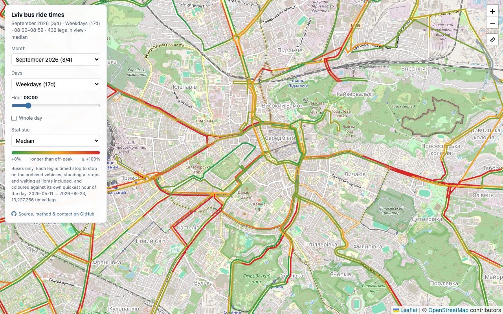
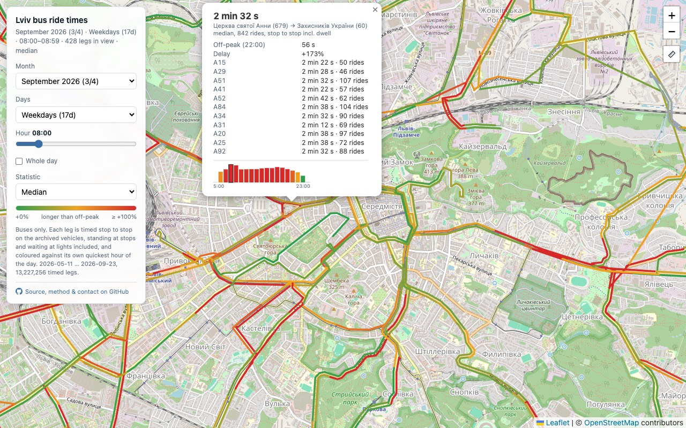

# gtfs-speedmap

[English](README.md) · **Українська** · [Методологія для аналітиків](#методологія)

Карта OSM із **часом поїздки автобусами** Львова. Кожен перегін мережі (від зупинки до зупинки)
намальовано вздовж вулиці, якою їдуть автобуси, окремою лінією для кожного напрямку руху, і
пофарбовано за тим, наскільки довше він триває в обрану годину, ніж у **свою власну найшвидшу
годину доби**: зелений +0%, червоний +100% і більше. Повзунок години, вибір місяця, будні й
вихідні окремо. Клік по перегону показує його час для кожного маршруту й по годинах; лінійка
вимірює поїздку між будь-якими двома точками.



Побудовано зі знімків GTFS-RT з позиціями машин, які
[`gtfs-collector`](../gtfs-collector) складає в архів у Cloudflare R2.

```
R2  raw/YYYY-MM-DD/*.pb           знімки GTFS-RT, кожні ~10 с
R2  static/YYYY-MM-DD/static.zip  розклад GTFS, яким він був того дня
        │  python -m speedmap.ingest --all   (кожен знімок читається раз і йде в обидва проходи)
        ▼                                       ▼
data/seg/YYYY-MM-DD.parquet                 data/agg/YYYY-MM-DD.parquet
  часи перегонів за ключем                    прохід швидкості, не на карті
  (місяць, година, маршрут, напрямок, пара)   (див. «Прохід швидкості» нижче)
data/seghist/YYYY-MM-DD.parquet             data/hist/YYYY-MM-DD.parquet
  той самий ключ плюс 5-секундний кошик
data/paths/YYYY-MM.json                     форми маршрутів і порядок зупинок, з розкладу
        │  python -m speedmap.sync push     ⇄  R2 derived/
        │  python -m speedmap.build_web
        ▼
web/data/paths-{month}.json                 лінії маршрутів і порядок зупинок
web/data/rides-{month}-{days}-{hour}.json   часи перегонів для кожного маршруту — карта й лінійка
web/data/month-{month}.json, index.json     меню
        │  make deploy
        ▼
Cloudflare Worker (лише статичні файли)
```

## Що означає колір

Перегін — це відрізок між двома сусідніми зупинками, виміряний від прибуття на одну до прибуття на
наступну, тож стояння на зупинці й очікування на світлофорах — його частина. Більшість перегонів
проїжджає більше ніж один маршрут; карта малює пару зупинок один раз і об'єднує часи маршрутів зі
вагою за кількістю поїздок кожного.

Далі кожен перегін порівнюється лише сам із собою. Його час **поза піком** — це найшвидша година
того самого місяця, типу днів і показника серед годин, де об'єднаних поїздок щонайменше
`OFFPEAK_MIN_RIDES` (10), а колір — це `час ÷ поза піком − 1`: зелений на +0%, через бурштиновий,
червоний на `DELAY_HIGH` (+100%) і далі. Так затори відділено від відстані — довгий перегін на
околиці не червоний через те, що він довгий, а короткий у центрі червоніє, лише якщо його
розтягує пік. Перегін без години поза піком (замало поїздок у кожній годині) — сірий.

Лінії зсунуто праворуч від напрямку руху, тож два напрямки однієї вулиці лежать поруч, як смуги,
і з наближенням стають ширшими. Клік вибирає ту лінію, на яку влучив.



Вікно показує об'єднаний час і на скількох поїздках він ґрунтується, час і годину поза піком,
затримку, кожен маршрут на цьому перегоні з його власним часом і кількістю поїздок і стовпчик на
кожну годину доби, пофарбований так само. Об'єднання, час поза піком і колір рахує браузер із
файлів по маршрутах, тож зміна показника чи години не завантажує нічого, що вже є.

## Що вважається поїздкою

Кожна сутність GTFS-RT — кандидат; вона лишається, лише якщо виконано все нижче.

| Фільтр | Навіщо |
|---|---|
| Маршрут — **автобус** | `route_type == 3` **і** коротка назва не починається з `Тр`. Самого `route_type` замало: тролейбуси Львова (`Тр22`…`Тр38`) опубліковано як `route_type=3`, а трамваї — `route_type=0`. |
| Позначка часу машини свіжа | Потік повторно публікує машини, чий власний `timestamp` на години старий (p50 = 14 с, але p99 ≈ 17 год). Сутності, що відстають від заголовка потоку більше ніж на `STALE_MAX_S`, — привиди. |
| `(vehicle_id, timestamp)` ще не траплялася | Збирач опитує кожні 10 с, а потік повторює незмінні сутності. |
| У межах Львова | Відкидає випадкові координати. |

Нічого біля зупинок не відкидається: стояння на зупинці — частина поїздки, яку цей прохід і
вимірює.

## Як вимірюється перегін

[`segments.py`](src/speedmap/segments.py) складає день кожної машини в рейси, знаходить момент,
коли рейс був найближче до кожної зупинки свого маршруту (в межах `STOP_PASS_RADIUS_M`), і
зберігає час між сусідніми зупинками.

Ключ перегону — **пара зупинок**, а не рейс, тож кожен варіант маршруту живить той самий перегін,
а перегін іде від прибуття до прибуття — тому сума на відрізку складається рівно в час від
прибуття на першу зупинку до прибуття на останню.

| Відкинуто | Навіщо |
|---|---|
| Перегін через дірку в потоці довшу за `SEG_GAP_MAX_S` | Машину на ній не бачили, тож перегін може бути не тим, чим здається. |
| Перегін довший за `SEG_MAX_S` | Це не перегін: автобус зламався, його зняли з лінії або він пересидів об'їзд. |
| Перегін задом наперед | Найближчий підхід може стати не по порядку, коли дві зупинки поруч, а GPS блукає. |
| Тиша довша за `RUN_GAP_MAX_S` | Закінчує рейс. Машина зберігає trip_id і на кінцевій, тож без цього «перегін» міг би охопити розворот. |
| Перегін, який бачили менше ніж `SEG_MIN_OBS` разів | Один автобус із поганим ранком — не медіана. Позначається як дірка, а не заповнюється мовчки. |

Відкинуто близько 1% кандидатів, і 96% із 3 107 пар сусідніх зупинок мережі мають досить
спостережень для публікації.

Цей прохід не читає розклад, тож розклад — безкоштовна перевірка для нього. Порівняно зі
`stop_times.txt` розкладу, за яким їхали машини, на 3 038 парах, що є в обох:

| виміряне ÷ за розкладом | p10 | медіана | p90 |
|---|---|---|---|
| | 0.53 | **0.94** | 1.76 |

Медіанний виміряний перегін — 111 с проти 120 с за розкладом: автобуси трохи частіше випереджають
розклад, ніж відстають, а розкид в обидва боки, година за годиною, і показує карта.

## Будні й вихідні

Усереднення всього тижня ховає пік, тож карта відкривається на буднях, а вихідні й усі дні —
поруч. Субота й неділя досить схожі між собою і досить відмінні від буднів, тож мають один кошик
«вихідні», а не ділять поїздки кожного перегону на три. Тип дня береться з назви кожного parquet,
тож поділ не коштує додаткового проходу по R2.

## Який показник

`data/seg/` зберігає накопичені суми, а `data/seghist/` — гістограму часу перегону в кошиках по
`SEG_BIN_S`, тож обидва показники виходять з однієї збірки.

| Показник | На що відповідає |
|---|---|
| Медіана | Як перегін їдеться зазвичай; стійка до одного автобуса, що пересидів об'їзд. За замовчуванням. |
| Середнє | Цифра, що складається вздовж поїздки — див. лінійку нижче. |

Перегін, який у комірці бачили менше ніж на `SEG_MIN_OBS` поїздках, не показано (`null`), а не
вгадано.

## Час поїздки між двома точками

Кнопка лінійки поруч із кнопками масштабу відповідає на «скільки я їхатиму». Поставте точку там,
де ви є, і ще одну там, куди їдете, — і вона покаже кожен маршрут, що їде між ними, з часом за тими
самими перегонами, що й карта.

### Від двох точок, а не двох зупинок

Перегони виміряно від зупинки до зупинки; питання так ніколи не ставлять. Обидва кінці лінійки
проєктуються на **форму** кожного маршруту — вулицю, якою справді їде автобус, із `shapes.txt`
розкладу, — і маршрут підходить, коли проходить ближче ніж за `RIDE_NEAR_M` від обох у тому
порядку, в якому їх проїжджає. Зупинки тоді — просто позначки вздовж лінії: відрізок, що покриває
три з половиною перегони, рахується як три з половиною, а частина перегону — пропорційно тому,
скільки її покрито. Це припускає рівний темп у межах перегону, який за медіаною — квартал у 460 м.

Три речі, які треба було зробити правильно, і кожна спершу була неправильною:

| Пастка | Що вона робила | Виправлення |
|---|---|---|
| Маршрут, що повертається назад | Ставив два кінці на різні проходи, тож 1,15 км вулиці виходили як 2,6 км на 32 км/год | Брати кожен локальний мінімум відстані до лінії, а потім пару проходів, що дає найкоротший шлях |
| Зупинки прив'язувалися до форми по одній | Ставили зупинку на той прохід, що ближче; вимога «кожна після попередньої» закидала зупинки А58 на зворотний напрямок — стрибок на 23 км між сусідами | Прив'язувати всю послідовність одразу (Вітербі), з допуском на кількаметрові перестановки на крутому повороті |
| Щедрий радіус | За 250 м підходив маршрут із сусідньої вулиці й показував свій довший об'їзд | 150 м до лінії, плюс межа на те, наскільки маршрут може обходити порівняно з прямою |

Сім із 110 напрямків маршрутів мають зупинки, яких їхня форма не пояснює; для них береться ланцюжок
їхніх власних зупинок — та сама ідея з меншою точністю.

Маршрути впорядковано від найшвидшого, кожен — із зупинками посадки й висадки та кількістю
поїздок, на якій ґрунтується цифра. Перегін, на якому в цьому виборі нікого не бачили,
заповнюється середнім перегоном самого маршруту, і рядок каже, скільки таких. Вибраний маршрут
малює ділянку, яку виміряно.

Поруч із кожним часом — наскільки він довший, ніж поза піком: найшвидша година того самого місяця
й типу днів на тій самій ділянці, за тим самим показником, серед годин, де бачили щонайменше 10
поїздок.

### Чому поруч із медіаною є середнє

Додається лише середнє. Сума середніх по перегонах маршруту — це середнє всієї поїздки; сума
медіан по перегонах **не** є медіаною поїздки, бо час перегонів має правий хвіст, а автобус, що
запізнився на одному перегоні, запізнюється й на наступному. На поїздці з десяти перегонів це
накопичується в цифру, яка просто надто швидка, — саме так про цю ваду й повідомили.

Виміряно на самих машинах — Рясне-2 → Ковча, десять перегонів, відправлення в годину 08:00 шести
липневих буднів, поїздки відтворено із сирого архіву, а не з жодних агрегатів:

| маршрут | Σ медіан перегонів | Σ середніх перегонів | медіана справжньої поїздки | середнє справжньої поїздки |
|---|---|---|---|---|
| А06 | 22.1 | 25.1 | **26.0** | 26.4 |
| А11 | 22.2 | 24.7 | **25.3** | 26.4 |
| А49 | 23.2 | 24.1 | **22.1** | 25.0 |

Сума середніх лягає в межах приблизно 5% від справжньої поїздки; сума медіан коротша на 10–15%.
Залишок на середньому — перегони, для яких рейс не дав пари проходів, — 13% перегонів А06, тобто
19% його часу, — заповнені з інших рейсів.

Лінійка все одно відкривається на медіані, як і карта, бо для *одного* перегону це стійкіша цифра.
Вводить в оману саме сума — для довгої поїздки перемкніться на середнє.

Три речі, на які вона не претендує. Вона не знає, коли рушить наступний автобус, тож очікування
немає, і маршрут, що ходить раз на 40 хвилин, виглядає так само, як той, що раз на 6. Частина
перегону оцінюється за відстанню, тож ділянка, що не доходить до зупинки, отримує рівну частку
перегону, а не чергу в його кінці. І цифри описують автобуси, що їхали, а не розклад.

## Методологія

Довідка для аналітиків, які хочуть перевикористати або перевірити цифри. Усе описане — в
[`segments.py`](src/speedmap/segments.py), [`build_web.py`](src/speedmap/build_web.py) і переглядачі
([`web/app.js`](web/app.js)), константи — в [`config.py`](src/speedmap/config.py).

### Джерела

| Джерело | Що це | Які поля |
|---|---|---|
| Потік GTFS-RT `VehiclePosition` львівського перевізника | Архівується кожні ~10 с збирачем `gtfs-collector` в R2 `raw/YYYY-MM-DD/*.pb`, ~245 МБ на день | заголовок `timestamp`; для кожної сутності `vehicle.id`, `vehicle.timestamp`, `trip.trip_id`, `trip.route_id`, `position.latitude/longitude` |
| Статичний GTFS | Архівується щодня в R2 `static/YYYY-MM-DD/static.zip` | `routes.txt` (тип, коротка назва), `trips.txt` (маршрут, `direction_id`, форма), `stop_times.txt` (порядок зупинок), `stops.txt`, `shapes.txt` |

Кожен день звіряється з найновішим статичним архівом, датованим цим днем або раніше. Дні до першого
архіву (2026-07-31) звіряються з найстарішим. trip_id, якого в архіві немає, прив'язується до
маршруту й напрямку за суфіксом `_<напрямок>` у самому id.

Покриття: з 2026-05-11, години 05–23 за місцевим часом (`Europe/Kyiv`) — о 00:00–04:00 збирач не
опитує. Близько 110 пар «маршрут-напрямок».

### Одиниця спостереження

Одна **поїздка перегоном**: одна машина в одному рейсі проїжджає від зупинки *k* до зупинки *k+1*
шляху свого маршруту. Значення — час між **найближчими підходами** машини до цих двох зупинок, тож
стояння, світлофори й черги — всередині. Від прибуття до прибуття, тож сусідні перегони одного рейсу
покривають його без дірок і накладань.

### Конвеєр, по днях

1. **Розбір.** Сутності без позиції, trip_id чи route_id пропускаються.
2. **Фільтр.**
   - Лише автобуси: `route_type = 3` і коротка назва не починається з `Тр`.
   - Не застарілі: `header.timestamp − vehicle.timestamp ≤ STALE_MAX_S` (120 с).
   - Без дублікатів за `(vehicle.id, vehicle.timestamp)`.
   - У межах прямокутника Львова (49.70–49.95 пн. ш., 23.85–24.20 сх. д.).
3. **Проєкція** в метри UTM 35N.
4. **Рейси.** Точки групуються за `(машина, trip_id, route_id)`, сортуються за часом і
   розрізаються там, де машина мовчала довше за `RUN_GAP_MAX_S` (600 с).
5. **Шлях.** Кожен маршрут і `direction_id` має один канонічний шлях — найдовший упорядкований
   перелік зупинок серед його рейсів. Кожен варіант міряється по ньому. Укорочений рейс не доїжджає
   до пропущених зупинок і там нічого не додає.
6. **Проходи зупинок.** Для кожної зупинки шляху момент проходу — це точка рейсу, найближча до
   зупинки в межах `STOP_PASS_RADIUS_M` (60 м). Береться позначка часу самої точки, без
   інтерполяції. При опитуванні раз на ~10 с це означає похибку до кількох секунд на кожному кінці.
7. **Перегони.** Перегін між сусідніми зупинками шляху *k*, *k+1*, які обидві мають прохід,
   лишається, окрім випадків, коли він:
   - іде задом наперед (`t₂ ≤ t₁`);
   - довший за `SEG_MAX_S` (1800 с);
   - охоплює дірку в даних довшу за `SEG_GAP_MAX_S` (240 с).
8. **Ключ.** `(місяць, година, route_id, напрямок, from_stop, to_stop)`. Місяць і година — за
   місцевим часом **початку** перегону.
9. **Зберігання.**
   - Кількість `n` і сума `sum_s` пишуться в `data/seg/YYYY-MM-DD.parquet`.
   - Гістограма з 5-секундних кошиків (`bin = floor(seconds / SEG_BIN_S)`) пишеться в
     `data/seghist/YYYY-MM-DD.parquet`.

Фільтри відкидають близько 1% кандидатів. Файли днів названо за датою UTC. Будні чи вихідні
визначаються з цієї назви, тож кілька перегонів біля півночі можуть потрапити до типу сусіднього дня.

### Агрегування

`build_web` будує по одному місяцю. Він сумує файли днів у комірки
`(місяць, тип днів, година, маршрут, напрямок, пара)`, де `тип днів ∈ {wd, we, all}` (пн–пт,
сб–нд, усі) і `година ∈ {05…23, all}`. Для кожної комірки:

| Показник | Формула | Примітка |
|---|---|---|
| `n` | кількість перегонів | кількість поїздок |
| `avg` | `sum_s / n`, округлено до 1 с | точне середнє |
| `med` | `(b + 0.5) × 5` с, де `b` — перший кошик, накопичена кількість у якому сягає `max(1, ⌈n/2⌉)` | медіана з точністю 5 с; при парній кількості — нижня з двох середніх |

Комірка з `n < SEG_MIN_OBS` (5) публікується як `null`, а її `n` зберігається, тож дірку видно,
а не заповнено.

### Що рахує переглядач

- **Об'єднання маршрутів на одній парі зупинок.** `t = Σ(tᵣ·nᵣ) / Σnᵣ` по маршрутах, що мають
  значення, де `tᵣ` — `med` або `avg` маршруту. Для `avg` це точне спільне середнє. Для `med` це
  наближення (зважене за поїздками середнє медіан), бо гістограми по маршрутах не публікуються.
- **Поза піком.** Мінімальне об'єднане `t` серед годин місяця (той самий тип днів і показник), де
  об'єднане `n ≥ OFFPEAK_MIN_RIDES` (10).
- **Затримка.** `t_година / t_поза_піком − 1`. Колір іде від зеленого на 0, через бурштиновий, до
  червоного на `DELAY_HIGH` (1.0) і вище. Сірий означає, що години поза піком немає.
- **Сума лінійки.** `Σ` значень перегонів маршруту між двома точками. Частини перегонів на кінцях
  беруться пропорційно відстані вздовж форми. Перегони без даних заповнюються середнім відомим
  перегоном маршруту й позначаються. Тут беріть `avg`: медіани не додаються (див.
  [вище](#чому-поруч-із-медіаною-є-середнє)).

### Опубліковані файли

Усі за адресою `https://gtfs-speedmap.vbhjckfd.workers.dev/data/`, звичайний JSON, без
авторизації:

| Файл | Вміст |
|---|---|
| `index.json` | місяці, покриті дні, години, кількість спостережень, пороги (`stop_pass_radius_m`, `min_observations`, `bin_s`) |
| `month-{YYYY-MM}.json` | дні місяця, кількість днів кожного типу, години, кількість перегонів |
| `paths-{YYYY-MM}.json` | `stops: {id: [lat, lon, назва]}`; `routes: [{route, dir, name, path: [id зупинок], shape?: [[lat, lon]], dist?: [м уздовж форми для кожної зупинки]}]` |
| `rides-{YYYY-MM}-{wd\|we\|all}-{HH\|all}.json` | `{"route\|dir": {med: [...], avg: [...], n: [...]}}` — масиви вирівняно за `path` маршруту: елемент *i* — це перегін `path[i] → path[i+1]`, у секундах |

Приклад — перегони кожного маршруту в будні о 08:00 у жовтні 2026, з назвами зупинок:

```python
import json, urllib.request
base = "https://gtfs-speedmap.vbhjckfd.workers.dev/data/"
get = lambda f: json.load(urllib.request.urlopen(base + f))
paths, rides = get("paths-2026-10.json"), get("rides-2026-10-wd-08.json")
for r in paths["routes"]:
    legs = rides.get(f"{r['route']}|{r['dir']}")
    if not legs:
        continue
    for i, (a, b) in enumerate(zip(r["path"], r["path"][1:])):
        print(r["name"], paths["stops"][a][2], "→", paths["stops"][b][2],
              legs["med"][i], legs["avg"][i], legs["n"][i])
```

Сирі parquet по днях (`data/seg`, `data/seghist`) не публічні. Там ті самі цифри з дрібнішою
деталізацією (рядок на кожен день).

### Перевірка

Конвеєр ніколи не читає часу прибуття зі `stop_times`, тож розклад — незалежна перевірка. На 3 038
парах, що є в обох, виміряне ÷ за розкладом — p10 0.53, **медіана 0.94**, p90 1.76. Поїздка з
десяти перегонів, відтворена із сирих позицій, лягла в межах ~5% від суми середніх по перегонах
(див. [вище](#чому-поруч-із-медіаною-є-середнє)).

### Зміщення й обмеження

- **Похибка моменту проходу.** При опитуванні раз на ~10 с і прив'язці до найближчої точки кожен
  кінець зсунутий до кількох секунд. Для перегону з медіаною ~110 с це шум, але для дуже коротких
  перегонів — суттєво.
- **Ефект виживання.** Перегони з діркою в потоці понад 240 с або довші за 30 хв відкидаються. Через
  це екстремальні збої недопредставлені, а середні трохи оптимістичні.
- **Відбір за рейсом.** Рахуються лише машини, що публікують trip_id і route_id. Переїзди поза
  рейсом не рахуються.
- **Прив'язка до години.** За часом початку перегону. Перегін, що почався о 08:59, рахується в 08.
- **Поза піком — відносна величина.** Перегін, завантажений у кожну спостережену годину, не має
  чистої бази, тож його затримку занижено.
- **Об'єднана медіана.** Наближення, як описано вище; точна, коли перегоном їздить один маршрут.
- **Розбіжність із розкладом.** Дні до 2026-07-31 звіряються з пізнішим розкладом. Близько 35%
  травневих trip_id у ньому немає, і їх прив'язано за маршрутом і напрямком.

## Як дані оновлюються

Завдання GitHub Actions ([`.github/workflows/rebuild.yml`](.github/workflows/rebuild.yml)) запускається о
02:00 UTC 1-го, 8-го, 15-го і 22-го числа. Імпорт зупиняється на вчорашньому дні, тож поточний
місяць завжди має ціле число тижнів, і вибір місяця це показує: *Вересень 2026 (1/4)*, *(1/2)*,
*(3/4)*. Запуск 1-го числа закриває щойно завершений місяць, який відтоді показує кількість днів,
як і решта. Поточний місяць, де даних менше ніж на тиждень, у меню не потрапляє.

Кожен місяць будується на окремому раннері лише з власних днів, тож пам'яті потрібно на один
місяць, хоч як розростається архів. Кожен час поза піком береться з самого місяця, тож завершений
місяць ніколи не треба перебудовувати через те, що прийшов наступний. Його файли карти лежать в
R2 у `derived/web/YYYY-MM/`, а крок deploy збирає звідти всі місяці й пише `index.json`. Звичайний
запуск, отже, будує один місяць — поточний. Запуск 8-го також перебудовує попередній, тож невдалий
запуск 1-го числа все одно закриє місяць за тиждень, а не лишить його на 3/4.

Після зміни збірки запустіть завдання вручну на вкладці Actions з months `all` — тоді кожен місяць
отримає свій раннер паралельно — або назвіть місяці: `2026-07 2026-08`. Вручну локально:

```bash
make update   # імпорт нових днів, перебудова всіх місяців, розгортання
```

`make ingest` читає лише дні, яких немає в `data/agg/` або `data/seg/`, тож тиждень коштує кілька
хвилин локально і чверть години на раннері. Карта показує свій діапазон дат на панелі, тож
застаріле розгортання про це каже, а не вдає актуальне.

`data/` не в git, а перебудова з нуля триває години. `speedmap.sync` дзеркалить його в той самий
бакет у `derived/` — чотири щоденні теки parquet, геометрію маршрутів кожного місяця й
`depots.json`, без якого депо рахувалися б вулицею. Раннери стартують порожніми й залежать від
цього:

```bash
make push     # вивантажити агрегати, яких немає віддалено
make pull     # завантажити агрегати, яких немає локально
```

Обидві команди — поза локальним шляхом `make update`: на машині, де вже є `data/`, нічого
завантажувати. Parquet після запису не змінюються, тож в обидва боки це лише порівняння назв
файлів. Після локального `make update` варто зробити `make push`, інакше наступний раннер
повторно імпортує ці дні (нешкідливо, лише повільно).

Завданню потрібні секрети репозиторію: `R2_ACCOUNT_ID`, `R2_ACCESS_KEY_ID`,
`R2_SECRET_ACCESS_KEY` (як у `.env`) і `CLOUDFLARE_API_TOKEN` (токен із *Workers Scripts: Edit*)
разом із `CLOUDFLARE_ACCOUNT_ID`.

## Встановлення

```bash
pip install -e ".[dev]"
cp .env.example .env    # доступ до R2 — той самий бакет і ключі, що й у gtfs-eta
```

## Використання

```bash
make ingest                   # кожен завершений день у R2 (не сьогодні, UTC); можна продовжити
make ingest DATE=2026-07-15   # один день
make build                    # зібрати в web/data/*.json
make serve                    # http://localhost:8000
make test
make deploy                   # опублікувати web/ як є, без збірки (Node з .nvmrc через nvm)
make deploy-data              # зібрати всі місяці, потім опублікувати
make update                   # імпорт нових днів, потім розгортання
```

`web/data/*.json` генерується і не в git, тож розгортання вивантажує те, що зробив останній
`make build`. `make deploy` — для коду: він пропускає збірку й відправляє `web/data/` як є на диску —
Wrangler вивантажує лише файли, яких ще немає на краю мережі, — і відмовляється, коли немає
`web/data/index.json`, бо розгортання без нього прибрало б живі дані. `make deploy-data` спершу
запускає `build`; його використовує `make update`.

`make ingest` читає ~245 МБ знімків за день один раз і живить обидва проходи — комірки швидкості
(`aggregate.py`) і часи перегонів (`segments.py`) — і лише той прохід, чийого результату немає.
Новий день коштує кілька хвилин. `ARGS=--force` переробляє дні, що вже є на диску; додайте
`--only speed` або `--only segments`, щоб переробити лише один прохід після зміни його фільтрів.

Дні обробляються паралельно (`JOBS`, типово 3), кожен в окремому процесі з `WORKERS` потоками
завантаження. Межа — пропускна здатність R2, а не процесор, тож більше завдань здебільшого додає
пам'яті (~1 ГБ на кожне); на швидшому каналі можна підняти.

День, що впав, повторюється через 30, 60 і 120 с — так переживається обрив Wi-Fi або хвилина після
пробудження зі сну. Три дні поспіль, що все одно падають, зупиняють запуск, а не валять решту архіву
за секунди; `caffeinate -i` не дає Mac заснути від бездіяльності, але не від закритої кришки, тож
тримайте її відкритою (або на живленні із зовнішнім дисплеєм) на весь `--force`.

## Прохід швидкості

Те саме читання архіву живить і другий прохід, [`aggregate.py`](src/speedmap/aggregate.py), якого
карта вже не показує. Він зберігає щоденні суми й гістограми швидкості для кожної 25-метрової
комірки й напрямку руху в `data/agg/` і `data/hist/`, відкидаючи точки біля зупинок на власному
рейсі машини, на кінцевих і в депо. Він лишається, бо
[`depots.py`](src/speedmap/depots.py) шукає в цих агрегатах депо й відстійники: комірки, де машини
нерухомі, яких багато, далеко від будь-якої проміжної зупинки, і які лишаються нерухомими в багато
різних годин доби.

[`data/depots.json`](data/depots.json) — результат, звірений з OpenStreetMap і закомічений;
`tests/test_depots.py` перевіряє його формат. Він маскує лише прохід швидкості — часи перегонів його
не бачать.

```bash
python -m speedmap.depots           # пошук, пише data/depots.json
python -m speedmap.depots --list    # показати, що збережено
python -m speedmap.depots --merge   # лишити відомі місця, додати нові знайдені
```

Пошуку потрібні агрегати, зібрані **без** маски, тож простий `discover` відмовляється перезаписати
наявний файл; `--merge` розширює його з замаскованих. Перезапустіть прохід через
`make ingest ARGS="--force --only speed"`.

## Налаштування

Параметри конвеєра — у `src/speedmap/config.py`, кожен читає однойменну змінну середовища. Зміна
будь-якого з них означає `make ingest ARGS="--force --only segments"`, крім `SEG_MIN_OBS`, якому
досить `make build`.

| Параметр | Типово | Що робить |
|---|---|---|
| `STOP_PASS_RADIUS_M` | 60 | Наскільки близько машина має підійти до зупинки, щоб прохід зарахувався. |
| `RUN_GAP_MAX_S` | 600 | Тиша такої довжини закінчує рейс, тож перегін ніколи не охоплює стоянку на кінцевій. |
| `SEG_MAX_S` | 1800 | Довші перегони — поломки чи об'їзди, а не перегони. |
| `SEG_GAP_MAX_S` | 240 | Дірка в потоці такої довжини всередині перегону відкидає його. |
| `SEG_BIN_S` | 5 | Роздільність гістограми часу перегону, а отже й медіани. |
| `SEG_MIN_OBS` | 5 | Менше поїздок у комірці — і перегін не показано. |
| `SHAPE_TOLERANCE_M` | 8 | Спрощення форм маршрутів, уздовж яких карта малює перегони. |
| `STOP_MATCH_MAX_M` | 120 | Наскільки далеко від своєї форми може стояти зупинка, щоб її ще прив'язало. |
| `STALE_MAX_S` | 120 | Поріг для сутностей-привидів. |

Власні константи переглядача — на початку [`web/app.js`](web/app.js): `DELAY_HIGH` (1.0, затримка,
що малюється повністю червоною) і `OFFPEAK_MIN_RIDES` (10). Прохід швидкості й пошук депо мають
власний блок у `config.py`.

## Мови

Сторінка говорить англійською й українською; перемикають два прапорці на панелі. Усі тексти — у
[`web/i18n.js`](web/i18n.js); статична розмітка має ключі `data-i18n` і перекладається на місці,
тож сторінка й канонічна адреса лишаються одні. Без `lang` карта відкривається мовою, яку відвідувач
вибрав минулого разу, інакше — українською для українського, російського чи білоруського
браузера й англійською для решти.

## Посилання на вигляд

Увесь вибір живе в рядку запиту разом із видимою ділянкою, тож посилання може вести на одне
перехрестя, а не на все місто:

```
https://gtfs-speedmap.vbhjckfd.workers.dev/?month=2026-07&days=wd&hour=08&stat=med&lang=uk&z=16&lat=49.8408&lon=24.0219
```

`month` приймає `YYYY-MM` (старе посилання з `all` падає на типовий місяць); `days` — `all`, `wd` або
`we`; `hour` — `all` або `00`–`23`; `stat` — `med` або `avg`; `lang` — `en` або `uk`. Усе
нерозпізнане падає на типове значення, а не дає помилку. Без рядка запиту карта відкривається на
найновішому місяці, який дані покривають від початку до кінця, лише будні — у вихідні рух здебільшого
вільний, тож проблеми видно саме в будні. Посилання без `days` теж отримує будні. Канонічна адреса
навмисно лишається на голій головній — одна сторінка для пошукових систем, а не тисяча майже
однакових. Рух повзунка й карти використовує `replaceState`, тож перетягування не ховає
попередню сторінку під двадцятьма записами історії.

Без рядка запиту взагалі карта відкривається на поточній годині **за Києвом**, а не за часовим
поясом відвідувача, підтягнутій до найближчої години, коли збирач справді опитує.

## Відомі артефакти

- Годин 00:00–04:00 немає: збирач тоді не опитує.
- Архіви `static/` починаються лише 2026-07-31, тож раніші дні звіряються з найстарішим архівом.
  Близько 35% травневих trip_id там уже немає — саме це покриває запасний варіант за маршрутом і
  напрямком.
- Час поза піком — це найшвидша *виміряна* година перегону. Перегін, що їздиться лише в пік, не має
  тихої години для порівняння, тож виглядає зеленішим, ніж їдеться.

## Ліцензія

[WTFPL](LICENSE). Робіть із цим що хочете.

Дані, на яких це побудовано, не мої, щоб їх переліцензовувати: позиції машин — із GTFS-RT-потоку
львівського перевізника, а підкладка — © учасники OpenStreetMap.

## Контакти

[github.com/vbhjckfd/gtfs-speedmap](https://github.com/vbhjckfd/gtfs-speedmap) — issues і pull
requests вітаються.
